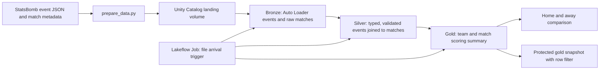

# Barcelona 2020/21 La Liga match events

## Research question

**Across Barcelona's 35 available 2020/21 La Liga matches featuring Lionel Messi, did the team create more and better scoring chances at home or away?**

The measures are shots per match, expected goals (xG) per match, xG per shot, and actual goals per match. Home and away results are compared as per-match averages because the source contains 18 home and 17 away matches.

| Venue | Matches | Shots per match | xG per match | xG per shot | Goals per match |
| --- | ---: | ---: | ---: | ---: | ---: |
| Home | 18 | 16.11 | 2.193 | 0.136 | 2.39 |
| Away | 17 | 14.88 | 1.914 | 0.129 | 2.24 |

Barcelona recorded higher shot volume and xG per match at home in this **35-match sample**. These are descriptive differences; they do not establish a causal home advantage or describe all 38 league fixtures.

## Source and scope

The data comes from [StatsBomb Open Data](https://github.com/hudl/open-data), specifically the [Messi Data Biography](https://blogarchive.statsbomb.com/articles/soccer/welcome-to-the-messi-data-biography/) La Liga 2020/21 collection (`competition_id = 11`, `season_id = 90`). Its [match metadata](https://github.com/hudl/open-data/blob/master/data/matches/11/90.json) references 35 event JSON files. The three Barcelona league fixtures without Messi are outside this collection: Barcelona–Eibar (29 December 2020), Elche–Barcelona (24 January 2021), and Eibar–Barcelona (22 May 2021). The fixture comparison uses the [2020/21 La Liga results CSV](https://www.football-data.co.uk/mmz4281/2021/SP1.csv).

`prepare_data.py` extracts nine documented event fields from the nested JSON, without generating football events. The prepared source contains 139,030 events and 839 shots by both teams. The 35 event files are divided into two upload batches to demonstrate incremental ingestion. The source URL and SHA-256 hash for each event file are recorded in `data/generated/manifest.csv`. See [DATA_DICTIONARY.md](DATA_DICTIONARY.md) for field definitions and null rules.

## Architecture

The dedicated Unity Catalog catalog is `barca_final_project`, with `bronze`, `silver`, `gold`, and `security` schemas. The event grain is one `event_id` per recorded event; many events share one `match_id`. The gold grain is one team per match.

| Component | Purpose |
| --- | --- |
| `notebooks/00_config.py` | Create project schemas and landing volume. |
| `notebooks/01_bronze.py` | Incremental Auto Loader ingestion with source path, schema location, and checkpoint. |
| `notebooks/02_silver.py` | Cast, validate, deduplicate by `event_id`, join by `match_id`, and record quality metrics. |
| `notebooks/03_gold.py` | Build the constrained team-by-match summary and answer the research question. |
| `notebooks/04_quality_evidence.py` | Demonstrate rejected null and negative-value rows outside the pipeline job. |
| `notebooks/05_governance.py` | Apply narrow reader grants, a mapping-based row filter, and an email classification tag. |
| `notebooks/06_observability.py` | Query job system tables and document liquid clustering and `OPTIMIZE`. |

## Reproduce the pipeline

1. Run `python prepare_data.py` from the repository root. Python's standard library is sufficient. The script downloads the pinned JSON files and writes `data/generated/`.
2. In a Databricks workspace with Unity Catalog, create a new catalog named `barca_final_project` using Default Storage. Connect this GitHub repository as a Git folder at `/Workspace/Users/<your-user>/final_project_module_4/barca_events`, then run `notebooks/00_config` from that folder.
3. Upload `data/generated/matches_2020_21.csv` to `/Volumes/barca_final_project/bronze/landing/matches/`. Upload only the 17 `lote_1_*.csv` event files to `/Volumes/barca_final_project/bronze/landing/events/`, then run `01_bronze`. It should show **66,380** event rows.
4. Upload the 18 `lote_2_*.csv` files to the same event folder and rerun `01_bronze`. It should show **139,030** rows. Rerun it once more without new files; the count should remain unchanged. Auto Loader stores its schema and processed-file checkpoint in separate paths under the landing volume.
5. Run `02_silver` and `03_gold`. The expected results are 139,030 clean events, 35 matches, 70 gold rows, and 839 shots across both teams. Run the SQL cells in `04_quality_evidence` individually to capture the literal Delta rejection messages.
6. Run `05_governance` and `06_observability`. The secured gold snapshot is intentionally separate from the constrained analytical table because Databricks does not allow a row filter on a table with `CHECK` constraints.
7. Copy `deployment/job.example.json` to `deployment/job.json`, replace `<your-user>` with your Databricks workspace user, and create a Lakeflow Job with `databricks jobs create --json @deployment/job.json`. Its three notebook tasks run directly from the Git folder and depend on bronze → silver → gold. The active file arrival trigger monitors the project's event volume.

The public repository excludes the 35 prepared event CSVs; the script downloads and regenerates them from the pinned public source. The small match file, manifest, and summary are included for inspection.

## Version control

The Databricks Git folder is connected to this repository at `/Workspace/Users/<your-user>/final_project_module_4/barca_events`. Development used the `feature/databricks-pipeline` branch and [pull request #1](https://github.com/LuisAcuna-27/barca-2020-21-match-events/pull/1), which was merged into `main`. The Lakeflow Job runs the notebooks from that Git folder.

## Governance and operating notes

The `account users` principal receives `USE CATALOG`, `USE SCHEMA` on `gold`, and `SELECT` only on `gold.match_team_summary_secured`. The row filter returns rows only where `current_user()` has a matching `team_id` in `security.team_access`; an unmapped user sees zero rows. The mapping table is not granted to readers. The demonstration changes the current user's mapping from Barcelona (`217`, 35 visible rows) to Villarreal (`222`, two visible rows), then restores Barcelona. The email column is tagged `classification = email`.

The largest table by `DESCRIBE DETAIL` is `silver.events_clean` (4,083,491 bytes versus 2,908,730 bytes for bronze events). It is liquid-clustered by `match_id`. `OPTIMIZE FULL` was executed; this small table already occupied one file, so no file rewrite or query-speed gain is claimed.

See [EVIDENCE.md](EVIDENCE.md) for observed counts, job runs, quality errors, and governance results.

## Attribution

Data and event model: [StatsBomb Open Data](https://github.com/hudl/open-data). StatsBomb requests source attribution and use of its logo when publishing analysis based on this data; the logo above is served from Hudl's [public images repository](https://github.com/hudl/public-images). xG values are StatsBomb model estimates for individual shots, not observed goals.
